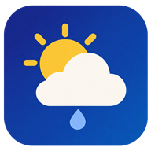
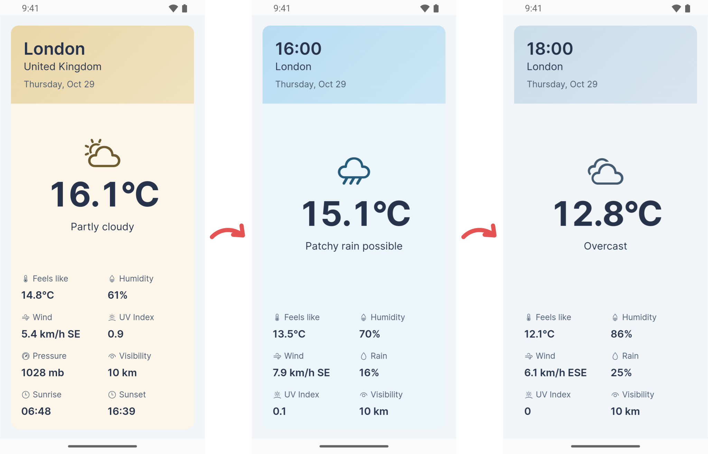
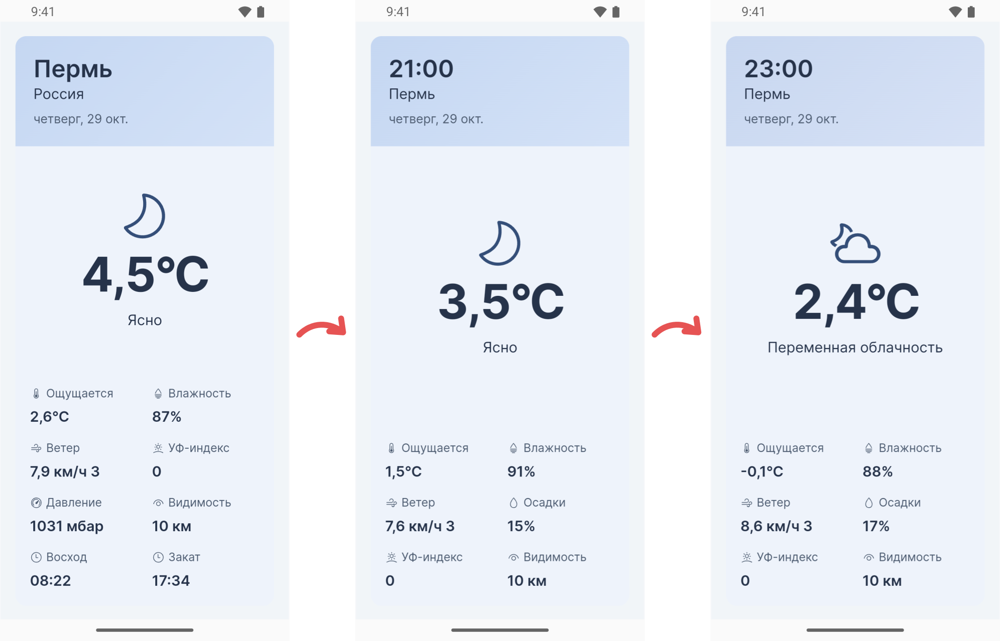

[Open ZoomWeather](https://gagarinbefree.github.io/ZoomWeather/)

# ZoomWeather

## English

**Weather without the clutter.** Open the site to see the weather right now, what is coming in the next few hours, and the forecast for the days ahead. No account or lengthy setup needed.

### Everything on one screen

Each card fills the screen. Current weather appears first, followed by the forecast for the days ahead. Soft card colors change with the weather.

**Swipe left or right** to see another time on the selected day.

**Swipe up or down** to move between days.

**See a loading indicator** while a card's forecast is on its way; you can keep browsing.

Cards show the temperature, conditions, and helpful details such as humidity, wind, and chance of rain. The number of forecast days depends on the available weather data.

### Weather where you are

ZoomWeather asks for permission to use your location. If you decline, it tries to find your approximate city through your internet connection. An internet connection is needed to refresh the weather.

### Install on your device

Open [ZoomWeather](https://gagarinbefree.github.io/ZoomWeather/) in your browser and choose **Install app** or **Add to Home Screen** from the browser menu. It opens like an app, without a store download. The last successful forecast stays available when you are offline, with the time it was saved. Reconnect and tap **Retry** to refresh it.

On Android, you can also [download the latest APK](https://github.com/gagarinbefree/ZoomWeather/releases/latest/download/ZoomWeather-Android.apk) and install it on your phone.

The interface is available in English and Russian. It is comfortable to use on a phone; on a computer, the card keeps its portrait layout, and you can browse with the arrow keys.

[Check the weather](https://gagarinbefree.github.io/ZoomWeather/)

## Русский

**Погода без лишнего.** Откройте сайт и сразу узнайте, какая погода сейчас, что ждёт вас в ближайшие часы и в следующие дни. Без регистрации и долгих настроек.

### Всё на одном экране

Каждая карточка занимает экран целиком. Сначала появляется текущая погода, затем прогноз на другие дни. Цвета карточек мягко меняются вместе с погодой.

**Свайп влево или вправо** показывает погоду в другое время выбранного дня.

**Свайп вверх или вниз** открывает прогноз на следующий или предыдущий день.

**Индикатор загрузки** появляется, пока прогноз для карточки готовится. Можно продолжать листать.

На карточках есть температура, погодные условия и полезные подробности: влажность, ветер, вероятность дождя и другие доступные показатели. Число дней прогноза зависит от доступных данных.

### Погода там, где вы находитесь

ZoomWeather попросит разрешение определить ваше местоположение. Если вы не предоставите доступ, сайт попробует определить город приблизительно по подключению к интернету. Для обновления погоды нужен интернет.

### Установка на устройство

Откройте [ZoomWeather](https://gagarinbefree.github.io/ZoomWeather/) в браузере и выберите в его меню **Установить приложение** или **Добавить на главный экран**. После этого погода открывается как обычное приложение. Последний успешно полученный прогноз доступен и без сети; рядом указано время сохранения. Когда интернет появится, нажмите **Повторить**, чтобы обновить данные.

На Android также можно [скачать APK последней версии](https://github.com/gagarinbefree/ZoomWeather/releases/latest/download/ZoomWeather-Android.apk) и установить его на телефон.

Интерфейс доступен на русском и английском языках. Сайт удобно открывать на телефоне; на компьютере карточка сохраняет вертикальный вид, а прогноз можно листать стрелками клавиатуры.

[Смотреть погоду](https://gagarinbefree.github.io/ZoomWeather/)
